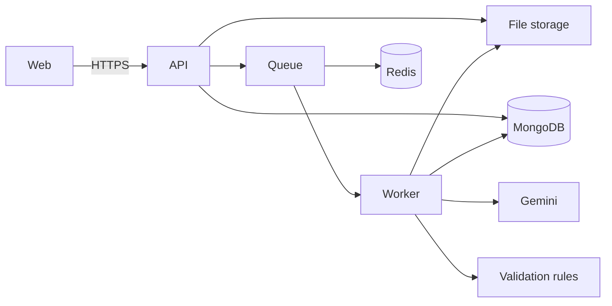

# Invoice Parser

Upload an invoice or purchase order. The app extracts the fields, checks the numbers, and holds the document for a person when something does not add up.

PDF and images go through Gemini. CSV and TXT are parsed in code. Validation never trusts the model: totals, dates, line math, duplicates, and VAT rates are checked by rules. A reviewer confirms or rejects the result. Each organisation only sees its own documents.

**Live demo:** https://invoice-parser-9xqd.onrender.com/

The demo is on Render's free tier, so the first request after idle can be slow. It may lag this repository until it is redeployed. See [docs/deploy.md](docs/deploy.md).

## Problem

Accounts teams still retype invoices. A model can read the page, but it will invent a total or miss a digit. This app keeps the model in the extraction step and puts the decision in deterministic checks plus a person.

## Architecture



Without `REDIS_URL`, the queue is in-process. With `S3_BUCKET`, files go to S3-compatible storage instead of local disk. The web app in Compose is nginx and proxies `/api` to the API. `npm start` can also serve the built UI from the API for a single host.

## Pipeline

1. Upload stores the file and returns immediately with status `uploaded`.
2. A job sets `processing`, picks a provider, and asks for structured JSON.
3. The payload is normalized and parsed with Zod. Invalid model output is rejected.
4. Rules check required fields, dates, line math, totals, duplicates, and VAT.
5. No errors becomes `validated`. Any error becomes `needs_review`. A thrown failure becomes `failed`.
6. A reviewer edits, confirms, or rejects. That action is stored in the audit log.

Statuses: `uploaded`, `processing`, `needs_review`, `validated`, `rejected`, `failed`.

## Decisions

Short notes live in [docs/adr](docs/adr):

- npm workspaces, not a second package manager
- Zod as the shared contract
- Provider interface, and model output is parsed before it is stored
- BullMQ when Redis is set, in-memory otherwise; local disk or S3
- Email, password, and an httpOnly JWT
- Money compared at the currency's minor unit

## Run

Node 22. Copy `.env.example` to `.env`. Set `MONGO_URI` and a `JWT_SECRET` of at least 16 characters. `GEMINI_API_KEY` is only needed for PDF and images.

```bash
npm install
npm run dev
```

The UI is at http://localhost:5173 and the API at http://localhost:3000. Register, then upload a file from `fixtures/invoices`.

```bash
npm run lint
npm run typecheck
npm test
npm run build
npm start
```

Compose, when Docker is running:

```bash
docker compose up --build
```

UI at http://localhost:8080. API health at http://localhost:3000/api/v1/health.

## Evals

`npm run eval` runs the CSV and TXT providers on `fixtures/invoices` and compares each field with the sibling `.expected.json`. Line items are compared as a whole. The command prints a percentage per file and exits non-zero unless every deterministic fixture is exact. CI runs this. It does not call Gemini. A live model pass is intentionally out of CI.

## Tests

Unit tests cover the rules, normalizer, parsers, queue idempotency, local storage, and CSV export. `apps/api/src/http/api.test.ts` boots the API against `mongodb-memory-server` and checks auth, processing, isolation, and reprocess.

GitHub Actions runs lint, typecheck, test, build, and eval.

## API

Versioned routes are under `/api/v1`. `/api/documents` and `/api/health` remain as aliases. OpenAPI: `GET /api/v1/openapi.json`.

## Screenshots

Real captures are not in the repo yet. The list of shots to take is in [docs/screenshots/README.md](docs/screenshots/README.md).

## Roadmap

- OAuth
- Server-sent events instead of polling
- OCR before the model for clean PDFs
- Lock a validated document against later edits
- Migrate documents that were stored before organisations existed
